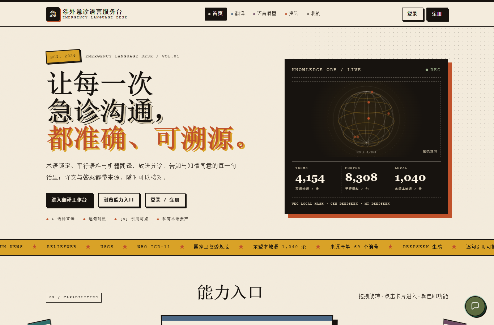

# 涉外急诊语言服务台 · Emergency Language Service Desk

   

面向**涉外急诊沟通**场景的语言服务原型：把患者口语、医学术语、东盟本地表达与可核查的知识来源，串成一条「术语 → 翻译 → 可溯源问答 → 结构化交接」的工作流。

前后端同仓、**无构建步骤**；本地 SQLite 开箱即跑，容器部署一条命令，生产可切 PostgreSQL + pgvector。全站中英双语，静态资源带版本号 + gzip + 长缓存。

> ⚠️ **免责声明**：本项目是**课程实训 / 教学演示作品**，不是医疗器械、不是临床决策支持系统。系统输出的译文、问答、告知单均**不得用于真实诊断、用药、分诊或任何医疗决策**；「患者情况告知单」只做患者自述的结构化整理与转达，**不翻译、不诊断、不评估表达质量**。真实场景请由具备资质的医护与专业译员复核。

---

## 在线演示

**https://er-lang-service-desk.app.workbuddy.host/?sharecode=F3VK3EZYS2**

演示站托管在 WorkBuddy 应用发布平台，需免费注册登录后使用（注册仅用于体验私有术语库 / 告知单留档，公共检索与首页无需登录）。链接与策略可能随平台调整；本地运行方式见下文，功能完全一致。



更多界面截图见 [`docs/screenshots/`](docs/screenshots/)。

---

## 它解决什么

| 障碍 | 表现 | 对应能力 |
| --- | --- | --- |
| 词不对 | 患者说「肚子上面疼」，病历要写「上腹部疼痛」 | 4,154 条公共术语 + 翻译前**术语锁定** + 译后校验强制替换 |
| 话不对 | 东盟英语变体、宗教禁忌、礼仪称谓导致语用失当 | 1,040 条本地语对照、738 条跨文化表达、150 条英语变体改写 |
| 答不了 | 想知道「预检分诊标准怎么规定」，搜索引擎给不出可核查出处 | 124 个知识切片 → 混合重排 → 强证据门槛，**库外明确拒答**，库内回答带可点开的 `[n]` 引用 |

设计上刻意做了两件事：**不知道就说不知道**（问答四层拒答，不编造），**来源必须可回溯**（每条引用可查看切片全文、章节、页码、来源编号与许可）。

---

## 功能一览

| 模块 | 能力 | 入口 |
| --- | --- | --- |
| 多语种翻译 | 中 / 英 / 越 / 泰 / 印尼 / 马来 6 语种 10 方向；术语锁定、句对上下文、译后校验；上游失败自动降级 | `/translate.html` · `POST /api/translate` |
| 可溯源问答 | hybrid 重排 → 证据门槛 → 库外拒答；引用可点开原文 | 全站悬浮球 · `POST /api/qa` |
| 患者情况告知单 | 圈选部位 / 症状 / 细节 + 患者原话 → 生成可编辑、可复制的交接单全文 | `/check.html` · `POST /api/patient-check` |
| 术语与语料 | 公共库只读（4,154 术语 / 8,308 句对）；个人私有库增删改查、CSV 导出、按用户隔离 | `/terms.html` `/corpus.html` `/account.html` |
| 语言质量 | 本地语、跨文化表达、英语变体三个子页签，按国家 / 禁忌级别筛选 | `/quality.html` |
| 外语资讯 | 4 源聚合（UN News / ReliefWeb / USGS / 联合国新闻中文版）→ 中文化 → 列表 | `/news.html` · `/api/news` |
| 语音输入 | 翻译页与告知单页可直接口述，见[语音识别](#语音识别三通道) | `static/js/voice-core.js` |
| 账户与安全 | 注册 / 登录 / JWT HttpOnly Cookie / CSRF 双提交 / 登录限流 / 审计日志 / 管理后台 | `/login.html` · `/api/admin/*` |

**双语**：全站中英切换，界面文案、动态错误、问答拒答、告知单标签同步切换；字典由 `scripts/build_i18n.py` 生成，带条数断言防止漏译。

---

## 技术栈

| 层 | 选型 | 说明 |
| --- | --- | --- |
| 后端 | FastAPI 0.162 + SQLAlchemy 2.1 + Pydantic Settings | 单进程单体，路由 / 服务 / 数据三层，模块间不横向调用 |
| 前端 | 原生 HTML + CSS + JS | **零构建**，不引入 npm / Vite，改完刷新即可见 |
| 数据库 | SQLite（默认）/ PostgreSQL + pgvector（可选） | `DATABASE_URL` 切换；向量检索本地用 numpy，PG 用 `<=>` |
| 向量 | 本地 1024 维哈希（离线兜底）/ 智谱 embedding-3 | 无 Key 也能完整跑通 |
| 翻译 | DeepSeek（主）/ Google 免键 / MyMemory / 演示兜底 | 逐级降级，每次失败记 `mt_degraded` 备注 |
| 生成 | mock（检索摘录）/ DeepSeek / 任意 OpenAI 兼容服务 | 浏览器永不直连上游，密钥只在服务端 |
| 部署 | Docker + Nginx，或任意容器平台 | `PORT` 环境变量 + `0.0.0.0` 绑定 |

三个关键取舍：**单体而非微服务**（课程项目，优先级是可跑通与可核查）；**向量存 SQLite/numpy 而非独立向量库**（数据量小，去掉一个运维组件）；**前端零构建**（避免工具链成为复现门槛）。

---

## 快速开始

要求 Python 3.11+（推荐 3.12）。**不需要 Node.js，不需要 npm install。**

```bash
# 1. 环境
python -m venv .venv
# Windows:  .venv\Scripts\python.exe -m pip install -r requirements.txt
# Linux/macOS: .venv/bin/python -m pip install -r requirements.txt

# 2. 配置（务必改掉 SECRET_KEY）
cp .env.example .env
python -c "import secrets; print(secrets.token_urlsafe(48))"   # 输出填进 .env 的 SECRET_KEY

# 3. 播种数据（幂等，约 1 分钟）
.venv/bin/python scripts/seed_public.py        # 术语/语料/来源/本地语/文化表达/英语变体
.venv/bin/python scripts/build_slices.py       # 124 个知识切片
.venv/bin/python scripts/embed_chunks.py --force
.venv/bin/python scripts/embed_corpus.py       # 8,308 句对向量

# 4. 启动
.venv/bin/python -m uvicorn app.main:app --reload --port 8000
```

打开 <http://127.0.0.1:8000>。`GET /api/health` 应返回 `status=ok` 及各项数据计数。

> Windows 用户可直接用 `start.ps1`；`start.sh` 适用于 Linux/macOS。
> 想跳过播种：直接 `docker compose -f deploy/docker-compose.prod.yml up -d --build`，镜像构建期会自动播种，首次约 2–5 分钟。

创建管理员（可选）：

```bash
.venv/bin/python scripts/create_admin.py --username admin --email admin@example.com --password '换成你的强密码'
```

---

## 环境变量

完整模板见 [`.env.example`](.env.example)，**所有密钥只写在 `.env`，该文件已被 `.gitignore` 忽略，切勿提交**。

| 变量 | 作用 | 默认 |
| --- | --- | --- |
| `SECRET_KEY` | JWT 签名密钥，生产必须随机 ≥32 字节 | `change-me-to-a-random-64-char-string` |
| `COOKIE_SECURE` | HTTPS 下必须 `true`，纯 HTTP 本地调试保持 `false` | `false` |
| `DATABASE_URL` | `sqlite:///./data/app.db` 或 `postgresql+psycopg://…` | SQLite |
| `EMBEDDING_PROVIDER` | `local`（离线哈希）/ `bigmodel`（智谱 embedding-3） | `local` |
| `LLM_PROVIDER` | `mock` / `deepseek` / `generic` | `mock` |
| `MT_PROVIDER` | `deepseek` / `generic` / `mymemory` / `mock` | `mymemory` |
| `DEEPSEEK_API_KEY` | DeepSeek Key（翻译与生成共用，仅服务端） | 空 |
| `ASR_PROVIDER` | `mock` / `http`（服务端中转第三方 ASR） | `mock` |
| `REFUSE_THRESHOLD` | 问答拒答阈值 | `0.35` |
| `QA_TOP_K` / `MAX_TEXT_LEN` | 检索条数 / 输入上限 | `5` / `2000` |

**没有任何 Key 也能跑完整流程**：向量走本地哈希、问答走检索摘录、翻译走免费通道并在额度用尽时降级为演示兜底（页面会明确标注 `degraded=true`，不会伪装成正常译文）。

需要稳定翻译时，在 `.env` 里配：

```env
MT_PROVIDER=deepseek
DEEPSEEK_API_KEY=你的key
```

降级链为 `deepseek → google（免键）→ mymemory → 演示兜底`。`GET /api/diag/upstream-probe`（需登录）可逐个探测上游连通性与耗时。

---

## 语音识别三通道

这点容易被误解，单独说明：**默认识别结果来自麦克风真实语音，不是预置示例文本。**

| 通道 | 实现 | 适用 |
| --- | --- | --- |
| `browser`（默认） | 浏览器 Web Speech API，实时转写 | Chrome / Edge，无需服务端配置 |
| `server` | `MediaRecorder` 录音 → `POST /api/speech/recognize`，需 `ASR_PROVIDER=http` | 浏览器不支持 Web Speech 时 |
| `demo` | 手动切换的固定示例文本，界面明确标注「不解析麦克风声音」 | 无麦克风环境的演示 |

真实模式下服务端若返回 `demo=true` 会直接报错，避免示例文本冒充识别结果。语音功能依赖**安全上下文**（`https://` 或 `localhost`），用 `http://IP` 访问时浏览器不会授权麦克风。

---

## 数据管线

```
data/*.jsonl（种子数据，随仓库提供）
   → seed_public.py        公共术语 4,154 / 语料 8,308 / 来源 69 / 本地语 1,040 / 文化表达 738 / 变体 150
   → build_slices.py       知识切片 124（保留章节、页码、来源编号、许可）
   → embed_chunks.py       切片向量（问答检索）
   → embed_corpus.py       句对向量（翻译上下文）
   → update_slices.py      增量更新（新增 / 变更 version+1 / 删除）
```

`data/app.db`（含账号与留档）**不入库**，由上述脚本现场生成；`Dockerfile` 在镜像构建期也会自动执行同一套播种，因此克隆仓库后无需手工准备数据库。

资讯聚合脚本：`scripts/crawl.py`（四源）+ `scripts/translate_news.py`（中文化）。

---

## 目录结构

```
.
├── app/
│   ├── main.py / config.py / db.py / models.py
│   ├── security.py / shield.py / deps.py / audit.py / i18n.py
│   ├── routers/     auth health terms corpus culture me translate qa news admin
│   │                refs patient_check speech diag
│   └── services/    embedding llm retrieval translate_service rag crawler asr
├── static/          14 个页面 + css/ + js/（原生，无构建）
├── scripts/         seed_public build_slices embed_* convert_* crawl create_admin …
├── data/            *.jsonl 种子数据（app.db 已忽略）
├── deploy/          docker-compose.prod.yml / nginx-site.conf / nginx.conf / entrypoint.sh
├── docs/            ARCHITECTURE / DEVELOPMENT_LOG / SITE_STATUS / 自检脚本 / screenshots
├── tests/           pytest 接口测试
├── Dockerfile / docker-compose.yml / render.yaml / requirements.txt / run_server.py
└── .env.example / start.sh / start.ps1
```

---

## API 概览

统一约定：JSON 请求响应；写接口需 JWT Cookie + `X-CSRF-Token` 双提交；输入长度与频率均有限流；错误文案随 `X-Lang` 返回中 / 英。

| 分组 | 代表端点 |
| --- | --- |
| 公开 | `GET /api/health` · `GET /api/public/overview` · `GET /api/terms` · `GET /api/corpus` · `GET /api/culture/*` |
| 账户 | `POST /api/auth/register` · `/login` · `/logout` · `GET /api/me/overview` |
| 翻译 | `POST /api/translate` · `GET /api/translate/history` |
| 问答 | `POST /api/qa` · `GET /api/qa/examples` · `GET /api/qa/source/{chunk_id}` |
| 告知单 | `POST /api/patient-check` |
| 语音 | `GET /api/speech/status` · `POST /api/speech/recognize` |
| 私有库 | `GET/POST/PUT/DELETE /api/me/terms` · `/api/me/corpus` · 导出 CSV |
| 诊断 | `GET /api/diag/upstream-probe`（需登录） |
| 管理 | `GET /api/admin/*`（管理员 + Nginx IP 白名单） |

交互式文档：启动后访问 `/docs`（FastAPI 自动生成）。

---

## 测试与自检

```bash
.venv/bin/python -m pytest tests/ -q
.venv/bin/python docs/selftest_ai.py           # 翻译 / 问答 / 降级链 37 项自检
.venv/bin/python -m compileall app scripts     # 语法检查
```

本地全量回归结果：API 冒烟 32/32、AI 自检 37/37、Playwright 端到端 81/81；静态资源 `?v=29` + `Cache-Control: immutable` + gzip 已生效（i18n 字典 167 KB → 52 KB）。

---

## 部署

| 方式 | 命令 / 入口 | 备注 |
| --- | --- | --- |
| 容器单机（推荐） | `docker compose -f deploy/docker-compose.prod.yml up -d --build` | 只监听 `127.0.0.1:3000`，Nginx 对外 80/443；`../data` 持久化 |
| Render / Fly.io / Railway | 连接仓库自动识别 [`render.yaml`](render.yaml) | 免费档无持久磁盘，重启会重置账号与留档 |
| 平台发布 | WorkBuddy 应用发布 | 当前在线演示所用方式 |
| Cloudflare Workers / Pages | ❌ 不支持 | 无常驻 Python 进程、无可写文件系统，装不了 SQLAlchemy |

自建服务器步骤（域名解析 → Nginx 模板 → `certbot` 签证书 → `COOKIE_SECURE=true`）详见 [`docs/DEVELOPMENT_LOG.md`](docs/DEVELOPMENT_LOG.md) 第 22 节。要点：**语音必须 HTTPS**；香港 / 海外节点免 ICP 备案，大陆节点需先备案。

---

## 安全与隐私

- 所有 API Key 只在服务端 `.env`；浏览器只请求同源 `/api/*`，不接触上游域名与凭据。
- `.env`、`*.db`、`.venv/`、`__pycache__/` 均在 [`.gitignore`](.gitignore) 中；**推送前请确认 `.env` 未被 `git add -f` 强制加入**。
- 公共库只读；私有术语 / 语料按 `user_id` 过滤，他人访问返回 404；问答只检索 `chunks` 表，不触碰私有数据。
- 会话 JWT 走 HttpOnly Cookie，写操作 CSRF 双提交校验，登录限流，写操作记审计日志。
- 应用自下发 CSP 与 `Permissions-Policy: microphone=(self)`；Nginx 模板不重复设置，避免拦掉麦克风。
- 演示站账号数据仅用于体验，不含真实患者信息。

---

## 数据来源与许可

| 数据 | 来源 | 说明 |
| --- | --- | --- |
| 术语 / 平行语料 / 本地语 / 文化表达 / 英语变体 | 课程项目自建总库（V1.3）整理、人工校订 | 教学与评审用途 |
| 外语资讯 | UN News、ReliefWeb、USGS、联合国新闻中文版 | 版权归原作者与机构所有，本项目仅作聚合与引用演示，保留原文链接与来源标注 |
| 知识切片 | 由上述资料与公开规范文档切片生成 | 每条切片记录来源编号、章节、页码与许可字段 |

**本项目尚未指定开源许可证**，代码仅供学习与评审参考；如需复用、二次开发或商业使用，请先通过 Issue 联系作者。第三方数据请另行遵守各自的使用条款。

---

## 已知限制

- 翻译质量依赖所接上游模型；免费通道可能限流，降级结果会明确标注，不宜直接用于医疗文书。
- 语音 `browser` 通道依赖浏览器 Web Speech API 与网络，`server` 通道需自行配置 ASR 服务。
- SQLite 适合单机演示；多实例并发需切 PostgreSQL + pgvector。
- 免费容器平台无持久磁盘，账号与留档会在重启后丢失。
- 术语 / 语料为课程整理数据，覆盖度与临床权威性有限，需专业审校后方可实用。

---

## 文档索引

| 文档 | 内容 |
| --- | --- |
| [`docs/ARCHITECTURE.md`](docs/ARCHITECTURE.md) | 分层架构、三类数据读写路径、翻译 / 问答 / 私有库时序、安全边界 |
| [`docs/DEVELOPMENT_LOG.md`](docs/DEVELOPMENT_LOG.md) | v1 → v29 完整开发日志（历史记录，含各轮验证数据） |
| [`docs/SITE_STATUS.md`](docs/SITE_STATUS.md) | 站点交付快照 |
| [`docs/RUBRIC_AUDIT.md`](docs/RUBRIC_AUDIT.md) | 功能点逐项自查 |
| [`CONTRACT.md`](CONTRACT.md) · [`DESIGN_V2.md`](DESIGN_V2.md) | 接口契约与早期设计稿 |
| [`docs/SELFTEST_*.md`](docs/) | 各轮自检记录 |

---

## 反馈

欢迎提 Issue 反馈复现问题、翻译质量或数据错误。若为课程评审用途，建议先看[在线演示](#在线演示)再按[快速开始](#快速开始)本地复现。
